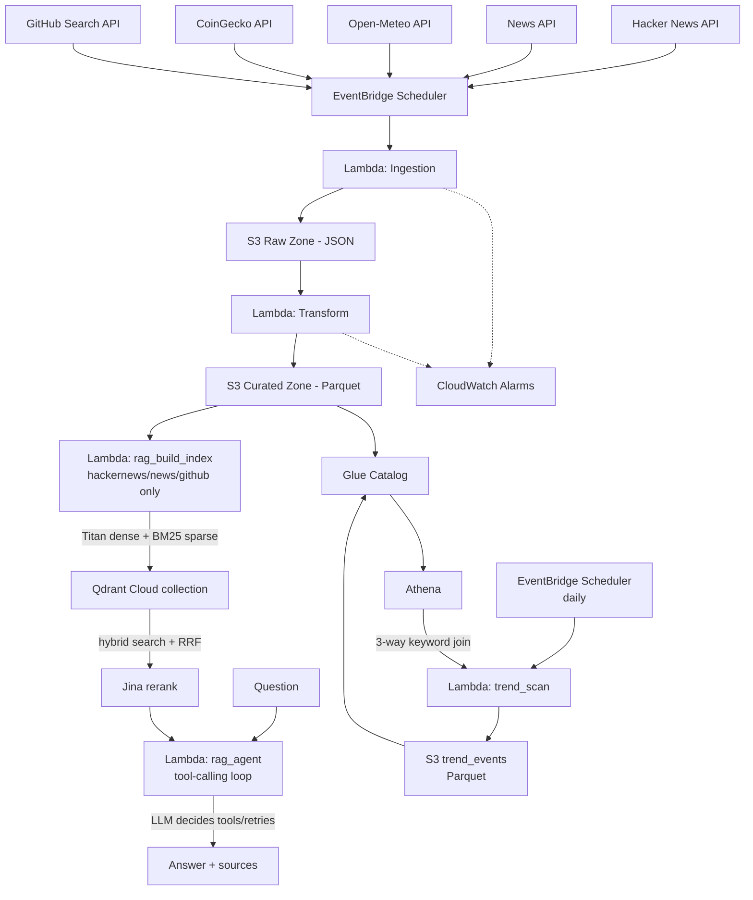

# Real-time Data Pipeline on AWS

Serverless ELT pipeline on AWS. It ingests Hacker News stories, news articles,
weather, crypto prices and trending GitHub repos, lands them in an S3 data lake
queryable with Athena, and adds an agentic RAG assistant on top.

## Questions to try

The RAG Assistant page (or the `rag_agent` Lambda) takes free-form questions in
any language. The tool column is what the agent usually reaches for; it chooses
tools on its own, so the trace can differ.

| Question | Typical tool |
|---|---|
| What are people discussing about AI safety and regulation? | `search_knowledge_base` |
| Any interesting AI agent or developer tools mentioned recently? | `search_knowledge_base` |
| What are people saying about PostgreSQL on Hacker News? | `search_knowledge_base` |
| Summarize the latest news about the semiconductor industry. | `search_knowledge_base` |
| Are there recent repositories related to LangChain or LlamaIndex? | `search_knowledge_base` |
| What are the current prices of Bitcoin, Ethereum and Solana? | `get_crypto_prices` |
| Which of the three coins moved the most in the last 24 hours? | `get_crypto_prices` |
| If I had bought 10 SOL 24 hours ago, how much has my position changed in percent? | `get_crypto_prices` |
| Which tracked location is the hottest right now, and which is the most humid? | `get_weather` |
| What are the current conditions in Bien Hoa, and is it raining there right now? | `get_weather` |
| Which Rust projects were trending on GitHub recently? | `search_knowledge_base` + `query_athena` |
| Which Hacker News stories got the highest scores in the last 24 hours? | `query_athena` |
| Which five Hacker News authors posted the most stories in the past week? | `query_athena` |
| What was Bitcoin's average price per day over the last week? | `query_athena` |
| Which topics are trending on both Hacker News and GitHub today? | `query_athena` + `search_knowledge_base` |
| Has the crypto market moved a lot today, and is Hacker News discussing it? | `get_crypto_prices` + `search_knowledge_base` |
| Who won the most recent football World Cup? | `search_web` |
| Quel est le prix du Bitcoin aujourd'hui ? | `get_crypto_prices` (answers in French) |

## Architecture



| Folder | What it does |
|---|---|
| `ingestion/` | One Lambda per source: Hacker News, NewsAPI, Open-Meteo (Vietnamese cities), CoinGecko (BTC/ETH/SOL), GitHub Search as a "trending" proxy. |
| `transform/` | Triggered by new raw objects: cleans, dedups, extracts keywords, writes Parquet to the curated zone. |
| `rag/` | On-demand agentic RAG over the curated zone (see Agentic RAG). |
| `trends/` | `trend_scan` (daily): finds keywords trending at the same time on GitHub, Hacker News and News API, writes Trend Events, shown on the web app's `/trends` page. |
| `common/` | Shared config, secrets, S3 and HTTP helpers. |
| `infra/` | Terraform for everything above. See `infra/README.md`. |
| `infra-bootstrap/` | One-time Terraform for the GitHub OIDC role CI/CD uses (no static keys). See `infra-bootstrap/README.md`. |
| `.github/workflows/` | `ci.yml`: lint, tests, `terraform validate`. `deploy.yml`: `terraform plan`, then a manually approved `apply` on push to `main`. |
| `web/` | Next.js app (dashboard, RAG assistant, explorer, ops, trends, cicd, weather, catalog, insights, settings). |
| `scripts/` | `build_lambdas.sh` packages the Lambdas; `telegram_*.sh` are the OpenClaw push automations (see OpenClaw). |

## Local development

```bash
python3 -m venv .venv && source .venv/bin/activate
pip install -r requirements-dev.txt
cp .env.example .env # DRY_RUN=true writes to ./local_output* instead of S3
pytest -q
ruff check .
```

Run a handler locally with no AWS resources:

```bash
DRY_RUN=true python -m ingestion.hackernews_ingestion # also weather, crypto, github_trending
DRY_RUN=true python -m ingestion.news_ingestion # needs NEWS_SECRET_NAME reachable
```

`DRY_RUN` only stubs the S3 write. Every source except NewsAPI is a public
API, so it needs no credentials.

## Deploying to AWS

1. Create a local-dev IAM user (one-time) -- see `infra-bootstrap/README.md`.
2. Run `infra-bootstrap/` once with that user to create the GitHub OIDC deploy role.
3. Push to `main` (or run `deploy.yml` manually) to plan and apply `infra/`.
4. Set the News API, Tavily, Qdrant Cloud and Jina keys in Secrets Manager (see `infra/README.md`).

## Ingestion performance

Two ingestion Lambdas fetched many URLs one after another -- Hacker News
(50 stories) and weather (12 cities). They now fetch up to 10 at the same time
(`common/http.py`). Same data, same order; one failed request still fails the run.

| Lambda | Sequential | Concurrent | Faster |
|---|---|---|---|
| `hackernews_ingestion` (50 requests) | 5.1s p50, 7.0s p95 | 1.8s p50 | ~3x |
| `weather_ingestion` (12 requests) | 6.2s p50, 11.8s p95 | 0.7s p50 | ~9x |

Sequential = CloudWatch, the 144 scheduled runs of the 3 days up to 2026-10-01.
Concurrent = 5 manual runs of each function right after the deploy. Hacker News
gains less because it has work that cannot be parallelised: it must first fetch
the list of story ids, and at the end it writes to S3; one slow story also holds
up the whole run. Weather's worst run dropped from 30.7s (against a 60s timeout)
to 2.0s. Shorter runs also cost less, since Lambda bills by run time.

## Sample analytics

`infra/glue.tf` registers a Glue database (`_curated`) with five
tables (`hackernews_stories`, `news_articles`, `weather_observations`,
`crypto_prices`, `github_repos`) using Athena partition projection. Query them in the Athena console
under workgroup `-analytics`. `sql/sample_queries.sql`
has ready-to-run examples, e.g. Hacker News vs News API keywords, crypto
mentions vs same-day price change, GitHub vs Hacker News keywords.

## Agentic RAG

`rag/` answers questions over the curated zone with Amazon Bedrock. Vectors
live in a Qdrant Cloud collection (free tier).

- **`rag/build_index.py`** (every 6 hours): embeds every record from the three
 text sources (`hackernews_stories`, `news_articles`, `github_repos`) with
 Titan (`amazon.titan-embed-text-v2:0`) and upserts it into Qdrant.
 It is incremental: it skips documents whose text hash and embedding model are unchanged.
 Weather and crypto are numeric and not worth embedding; the agent reads them with its own tools.
- **`rag/agent.py`** (on-demand): a tool-calling agent on Bedrock's Converse
 API. On each turn the model decides whether to call a tool, with what input,
 whether to search again, or to answer. Tools:
  - `search_knowledge_base`: hybrid search + RRF in Qdrant, then a Jina rerank of the top 30 down to 5.
  - `get_crypto_prices`, `get_weather`: exact, current data read from the curated zone.
  - `query_athena`: read-only SQL for aggregates (averages, counts, time windows).
  - `search_web` (Tavily): out-of-domain questions, fallback for everything else.

  The loop ends when the model answers in plain text, or after `MAX_ITERATIONS`
  (6), when one last call asks for a best-effort answer with tools withdrawn.
  Every tool call is returned in the `tool_calls` trace.

```bash
# 1. (Re)build the vector collection after new data lands
aws lambda invoke --function-name realtime-data-pipeline-dev-rag-build-index \
 --cli-read-timeout 300 /tmp/out.json && cat /tmp/out.json

# 2. Ask an in-domain question
aws lambda invoke --function-name realtime-data-pipeline-dev-rag-agent \
 --cli-binary-format raw-in-base64-out \
 --payload '{"question": "What is trending in AI right now?"}' \
 --cli-read-timeout 90 /tmp/agent-answer.json && cat /tmp/agent-answer.json

# 3. Ask an out-domain question
aws lambda invoke --function-name realtime-data-pipeline-dev-rag-agent \
 --cli-binary-format raw-in-base64-out \
 --payload '{"question": "What is a banh mi recipe?"}' \
 --cli-read-timeout 90 /tmp/agent-answer.json && cat /tmp/agent-answer.json
```

### Limitations

- **Weather** is the current observation at 12 locations (11 in southern
 Vietnam plus Da Lat), not a forecast.
- **Crypto** covers Bitcoin, Ethereum and Solana only. The 24-hour change comes
 from CoinGecko; for any other time window the agent has to query the history.
- **Time** ("today", "this week", "this month") is resolved against the current
 UTC date, and history only goes back to when ingestion started.
- **Read-only:** `query_athena` accepts a single `SELECT`.
- **Privacy:** the private Gmail table has no tool, so questions about emails cannot be answered.
- **Repeats:** an identical question can be served from the answer cache (the
 response then has `"cached": true`).

### Evaluation

`eval/run_ragas.py` scores the agent on faithfulness, answer relevancy
and context precision, judged by Bedrock. Dev-only (heavy `ragas` /
`langchain` dependencies, never deployed). Setup, dependency pins and the
latest numbers are in `eval/README.md`.

### Retrieval tuning

Uses hybrid search in Qdrant Cloud (Titan dense + BM25 sparse), merged with
Reciprocal Rank Fusion, plus a Jina reranker that picks the final 5 from the
top 30. The real gain is scale: the old index capped out around 1.4k documents
in a 512 MB Lambda, while Qdrant now holds all 34,977 and ingests incrementally.
Rerank costs roughly $0.0004 per search, within Jina's free allowance.

| Stage (12 questions, same agent/model, 1,158 docs) | Faithfulness | Answer relevancy | Context precision | Search p50 |
|---|---|---|---|---|
| Hybrid + RRF | 0.681 | 0.611 | 0.462 | 1,338 ms |
| Hybrid + RRF + rerank | 0.705 | 0.666 | 0.300 | 2,505 ms |

Caveat: small sample (12 questions) and the judge is a model with
its own noise, so differences under ~0.1 should not be trusted.

## OpenClaw ops agent

[OpenClaw](https://github.com/openclaw/openclaw) is a self-hosted personal AI
agent that runs on the dev machine and doubles as the ops agent for this repo
(its working directory is the repo root). It is not deployed to AWS and the
pipeline does not depend on it.

**Scheduled Telegram pushes.** Five cron jobs run the `scripts/telegram_*.sh`
scripts, which read the curated zone (or call a Lambda) and send the result to
one Telegram chat. Cron times are Asia/Saigon.

| Job | When | Sends |
|---|---|---|
| Trend digest | 06:30 | Today's trending keywords (`trend_events`); silent if none |
| Daily brief | 07:00 | Weather for 12 locations, BTC/ETH/SOL, top 3 GitHub trending |
| FinOps alert | 08:00 | Yesterday's AWS cost, only if above 1.5x the previous 7-day average |
| Data observability | 08:30 | Null rates per table, missing weather locations |
| RAG briefing | 23:00 | A `rag_agent` answer with its sources; one Bedrock call per day |

**Ops tasks on request:** run local tests with `DRY_RUN=true`, query Athena,
read logs when a CloudWatch alarm fires, summarise a `terraform plan`, and
answer news questions through the `rag_agent` Lambda.

**Guardrails.** The agent's rules live in its own `AGENTS.md`, outside this
repo. The main ones: it never runs `terraform apply`, never disables or deletes
AWS resources without asking first (pausing is done with
`aws events disable-rule`, never by editing Terraform), and never prints
secrets. Terraform changes follow *apply locally, then commit and push*. These
are instructions to a model, not enforced permissions.

**Setup.** Install OpenClaw, pair a Telegram bot, then register each script as
a cron job with `TELEGRAM_TARGET=` set. Secrets (bot token, gateway
token) are stored by OpenClaw, never in this repo.